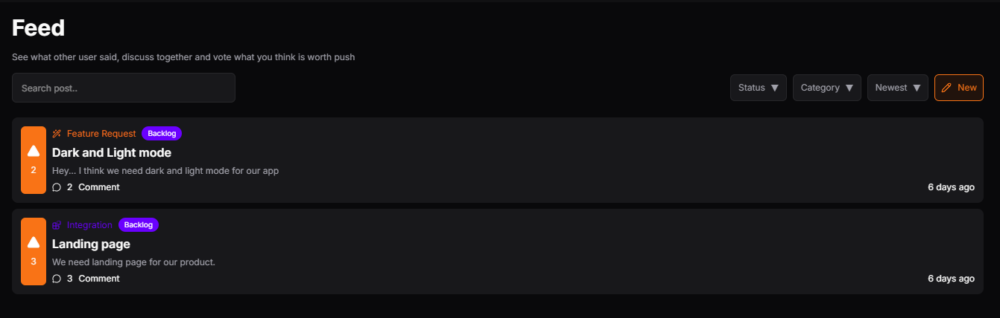
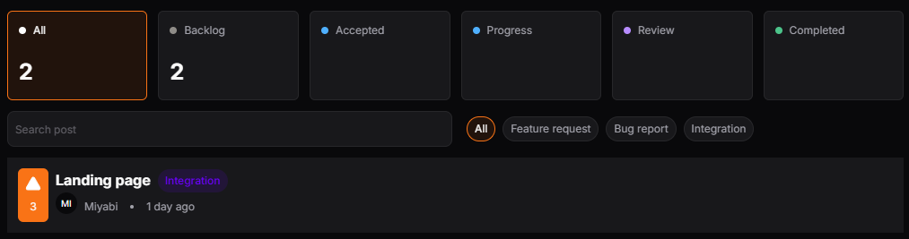
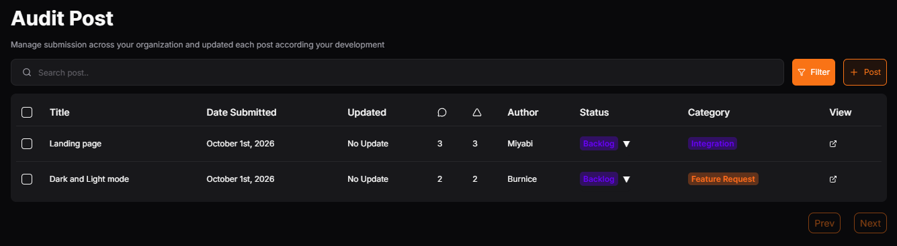

# Votify

Votify is a management feedback app for your organization. You can make a post about feature, integration, and bug report. Discuss your post with everyone and get an Vote to push your Idea.

Join multiple organization or make your own. Each organization have total 3 Roles (Owner, Admin, and Member).

     <i style="color: white" style>Suggest and Vote idea what matter to you</i>

### Tech Used

- Next JS
- Tailwind
- Prisma
- Neon Database

### Dependency Used

- Lucide
- date-fns
- Tiptap Rich Text Editor
- Motion
- Dompurify
- Shacnd/UI
- Zustand
- Yup
- React Hook Form

## Feature

### Feed

Explore your feed, see what other member discuss and join discussion

### Roadmap

Monitor each any idea where they progress based on their status, you can directly vote in Roadmap!

### Audit Post

Manage every submission, delete it or update its status.

### Manage Post

Manage your own post across all organization you join, and track their approval status

### Manage Member

See organization member list and manage their role. You can invite someone by email, and remove someone else as admin and owner

